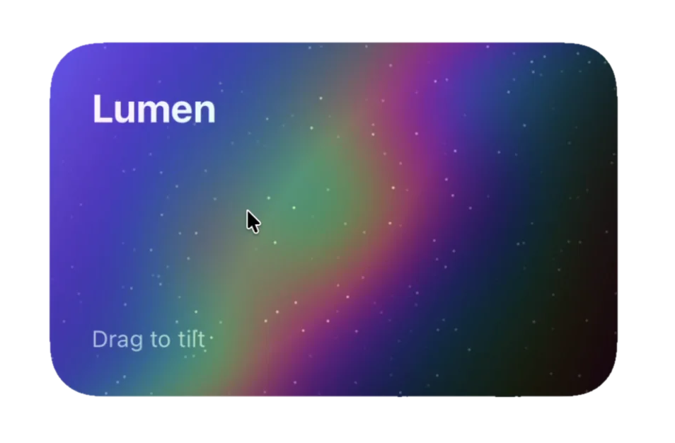
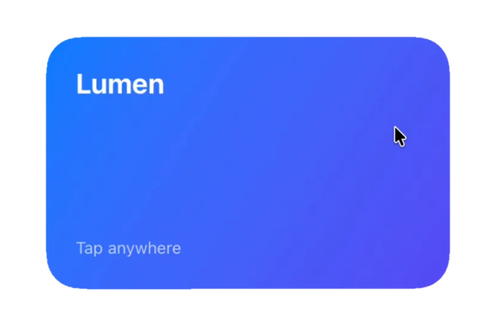

# Lumen

Metal-powered effects for SwiftUI. Each effect is a single view modifier backed by a GPU shader.

<p align="center">
  
  
</p>

> Early development. The API will change before 1.0.

## Effects

| Effect | Modifier | Status |
| --- | --- | --- |
| Holographic foil | `.holographic()` | Available |
| Touch ripples | `.ripple()` | Available |
| Liquid transition | `.transition(.liquid)` | Available |

## Usage

Add a foil that the user tilts by dragging:

```swift
import Lumen
import SwiftUI

struct MembershipCard: View {
    var body: some View {
        CardArtwork()
            .holographic()
    }
}
```

Pick a style, or drive the light yourself:

```swift
struct MembershipCard: View {
    @State private var tilt = Tilt.neutral

    var body: some View {
        CardArtwork()
            .holographic(tilt: tilt, style: .prismatic)
            .tiltable($tilt)
    }
}
```

`Tilt` is animatable, so the foil follows any SwiftUI animation you apply to it.

Send a ripple from wherever the user taps, or trigger one yourself:

```swift
PhotoView()
    .ripple()

PhotoView()
    .ripple(at: origin, trigger: likeCount, style: .shockwave)
```

Waves overlap, so quick taps build on each other instead of restarting.

Pour a view in and drain it out with a liquid surface:

```swift
if isUnlocked {
    RewardCard()
        .transition(.liquid)
}
```

Use `.liquid(from: .top)` to pick the edge. The surface reads best with an animation of about a second.

## Installation

In Xcode, choose **File > Add Package Dependencies** and enter the repository URL, or add it to `Package.swift`:

```swift
.package(url: "https://github.com/kareemalnajjar99/Lumen.git", branch: "main")
```

## Requirements

- iOS 17 or macOS 14
- Xcode 16

## License

Lumen is available under the MIT license. See [LICENSE](LICENSE).
